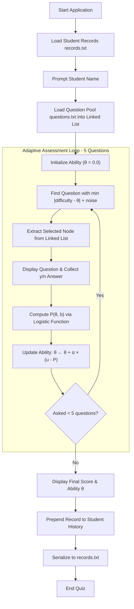

# 🎓 E-Learning Adaptive Quiz System

[](https://isocpp.org/)
[](https://opensource.org/licenses/MIT)
[]()
[-blueviolet)]()

A lightweight, high-performance **Computerized Adaptive Testing (CAT)** console application written in C++. 

Unlike conventional quizzes with fixed question sequences and static difficulty, this system evaluates the student's latent knowledge ability ($\theta$) in real-time using psychometric principles from **Item Response Theory (IRT)**. As the student answers questions, the difficulty dynamically adjusts—providing challenging questions for proficient students while gracefully easing difficulty for students who need reinforcement.

---

## 📌 Table of Contents

- [Key Features](#-key-features)
- [How It Works (Mathematics & Algorithm)](#-how-it-works-mathematics--algorithm)
  - [1. Item Response Theory (1PL / Rasch Model)](#1-item-response-theory-1pl--rasch-model)
  - [2. Online Ability Estimation](#2-online-ability-estimation)
  - [3. Optimal Question Selection](#3-optimal-question-selection)
- [System Architecture](#-system-architecture)
- [Repository Structure](#-repository-structure)
- [Data File Formats](#-data-file-formats)
  - [`questions.txt`](#questionstxt)
  - [`records.txt`](#recordstxt)
- [Compilation & Execution](#-compilation--execution)
  - [Prerequisites](#prerequisites)
  - [Linux / macOS](#linux--macos)
  - [Windows (MinGW / GCC)](#windows-mingw--gcc)
  - [Windows (MSVC / Developer Command Prompt)](#windows-msvc--developer-command-prompt)
- [Sample Run](#-sample-run)
- [Customization & Configuration](#-customization--configuration)
- [License](#-license)

---

## ✨ Key Features

- **Computerized Adaptive Testing (CAT)**: Dynamic item branching optimizes measurement precision while minimizing the number of questions needed to gauge ability.
- **Psychometrically Grounded**: Uses the **1-Parameter Logistic (1PL) / Rasch Model** from Item Response Theory.
- **Dynamic Linked Lists**: Custom singly linked list implementation for the question bank and student record storage with full dynamic memory allocation (`QuestionNode`, `StudentRecord`).
- **Zero Question Repetition**: When an item is selected from the bank, its node is safely extracted from the linked list, ensuring questions are never asked twice in a single session.
- **Comprehensive Question Bank**: Pre-loaded with 100 calibrated Yes/No questions ranging from basic knowledge (difficulty `-1.5`) up to advanced mathematical and scientific conjectures (difficulty `+3.0`).
- **Persistent Student Records**: Preserves student assessment histories (`name`, `correctCount`, `totalAsked`, `theta`) across sessions in `records.txt` with LIFO order-preserving stack serialization.
- **Zero External Dependencies**: Pure standard C++ (`<iostream>`, `<fstream>`, `<string>`, `<cmath>`, `<cstdlib>`). Compiles instantly on any modern C++ compiler.

---

## 🔬 How It Works (Mathematics & Algorithm)



### 1. Item Response Theory (1PL / Rasch Model)

The probability $P(\theta, b)$ that a student with latent ability $\theta$ correctly answers a question with difficulty $b$ is given by the standard logistic function:

$$P(\theta, b) = \frac{1}{1 + e^{-(\theta - b)}}$$

- When $\theta = b$: The student has exactly a **50% probability** ($P = 0.5$) of answering correctly.
- When $\theta > b$: The student's ability exceeds question difficulty, so $P > 0.5$.
- When $\theta < b$: The question is harder than the student's current ability, so $P < 0.5$.

### 2. Online Ability Estimation

Rather than solving computationally expensive Marginal Maximum Likelihood (MML) after the test, the engine updates the student's ability estimate in real time after every single response using stochastic gradient ascent:

$$\theta_{k+1} = \theta_k + \alpha \cdot \big(u_k - P(\theta_k, b_k)\big)$$

Where:
- $\theta_k$ is the current estimated ability level (starts at baseline $\theta_0 = 0.0$).
- $u_k \in \{0, 1\}$ is the actual response outcome ($1$ for correct, $0$ for incorrect).
- $P(\theta_k, b_k)$ is the expected probability of a correct response.
- $\alpha = 1.0$ is the adaptation learning rate (step size).

**Intuition**:
- If a student answers a difficult question correctly ($u=1$, small $P$), the error $(1 - P)$ is large and positive $\implies \theta$ jumps significantly upward.
- If a student answers an easy question incorrectly ($u=0$, large $P$), the error $(0 - P)$ is negative $\implies \theta$ drops downward.

### 3. Optimal Question Selection

To maximize measurement information, the engine selects the unasked question whose difficulty $b$ is closest to the student's current ability $\theta$:

$$\text{score} = |b - \theta| + \epsilon$$

Where $\epsilon \sim \text{Uniform}(0, 10^{-3})$ is a small random jitter to break ties and introduce variety across multiple attempts.

---

## 🏛 System Architecture

The project relies on clean, custom data structures without container library overhead:

- **`QuestionNode`**: Singly linked list storing individual questions. Supports dynamic search and $O(1)$ node excision once selected.
- **`StudentRecord`**: Singly linked list storing user test sessions.
- **Order-Preserving Stack Serialization**: When saving records back to disk, pointer addresses are pushed onto a stack buffer to preserve original chronological file order upon serialization.

---

## 📁 Repository Structure

```text
elearning-quiz-system/
├── elearningsystem.cpp    # Complete source code (IRT logic, linked lists, I/O)
├── questions.txt          # Calibrated question dataset (100 questions, -1.5 to +3.0)
├── records.txt            # Persistent student history and performance records
└── README.md              # Documentation and system guide
```

---

## 📄 Data File Formats

### `questions.txt`
Pipe-delimited text file storing available questions. Comment lines starting with `//` and blank lines are automatically ignored:

```text
<Question Text>|<Correct Answer (y/n)>|<Difficulty Level>
```

**Examples:**
```text
The Earth is a sphere.|y|-1.5
Sound travels at approximately 343 m/s in air at 20°C.|y|0.0
The Amazon River is the longest river in the world.|n|1.0
Fermat’s Last Theorem was proven by Andrew Wiles.|y|2.5
The halting problem is decidable.|n|2.5
```

### `records.txt`
Pipe-delimited text file logging completed quiz sessions:

```text
<Student Name>|<Correct Answers>|<Total Questions>|<Final Ability (Theta)>
```

**Examples:**
```text
Abdullah Khalid|5|5|2.5
Haram Abdullah|5|5|2.5
Ahad|4|5|1.5
Shazaib|2|5|-0.5
```

---

## 🚀 Compilation & Execution

### Prerequisites
- A standard C++ compiler supporting C++98, C++11, or newer:
  - **GCC / G++** ($\ge 4.8$)
  - **Clang / LLVM**
  - **MSVC** (Visual Studio 2017 or newer)

---

### Linux / macOS

```bash
# 1. Clone the repository
git clone https://github.com/abdulah-0/elearning-quiz-system.git
cd elearning-quiz-system

# 2. Compile with g++ or clang++
g++ -O2 -Wall elearningsystem.cpp -o elearningsystem

# 3. Run the executable
./elearningsystem
```

---

### Windows (MinGW / GCC)

```powershell
# In PowerShell or Command Prompt:
g++ -O2 -Wall elearningsystem.cpp -o elearningsystem.exe

# Run the program:
.\elearningsystem.exe
```

---

### Windows (MSVC / Developer Command Prompt)

```cmd
cl /O2 /EHsc elearningsystem.cpp /Fe:elearningsystem.exe
elearningsystem.exe
```

---

## 🖥 Sample Run

```text
Enter your name: Alex

=== Adaptive Quiz for Alex (5 questions) ===

Q1: The human heart has four chambers. (y/n)? y
Correct!

Q2: Mars is known as the Red Planet. (y/n)? y
Correct!

Q3: The largest organ in the human body is the skin. (y/n)? y
Correct!

Q4: Fermat’s Last Theorem was proven by Andrew Wiles. (y/n)? y
Correct!

Q5: NP = P has been proven. (y/n)? n
Correct!

=== Quiz Finished ===
Student: Alex
Score: 5 / 5 (100%)
Final ability (θ): 2.5
```

*(Notice how question difficulty escalated from general biology [0.0] up to Millennium complexity problems [2.5] as correct answers were submitted).*

---

## ⚙️ Customization & Configuration

You can easily adjust core parameters in `elearningsystem.cpp`:

| Parameter | Location | Default Value | Description |
| :--- | :--- | :--- | :--- |
| `QUIZ_SIZE` | `main()` line ~182 | `5` | Total number of questions per quiz session. |
| `learningRate` | `main()` line ~184 | `1.0` | Step size ($\alpha$) for updating ability $\theta$ after each response. |
| `theta` | `main()` line ~183 | `0.0` | Initial baseline ability level for a new student. |
| `NOISE_SCALE` | `pickNextQuestion()` | `1e-3` | Jitter scale added to question selection to prevent repetitive ordering. |

To add or modify questions, simply edit `questions.txt` following the `<Text>|<y/n>|<Difficulty>` format.

---

## 📜 License

This project is open-source and available under the [MIT License](https://opensource.org/licenses/MIT). Feel free to use, modify, and distribute it for educational and academic purposes.
